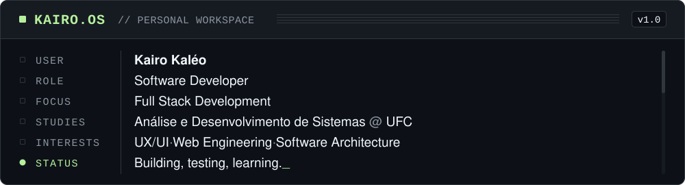
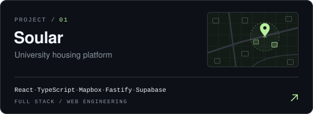
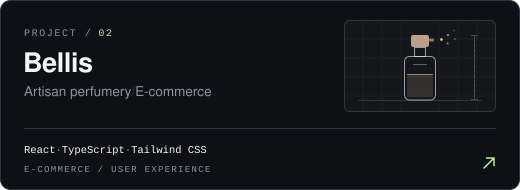
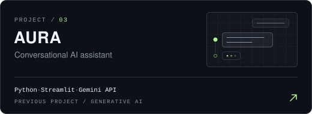

 <div align="center">


**Kairo Mesquita**

*Software Development · Full Stack · UX/UI*

[](https://kairo-mesquita.vercel.app/)
[](https://www.linkedin.com/in/devkairo)
[](https://github.com/DeveloperKairo)
[](mailto:contatodevkairo@gmail.com)

</div>

---

<p align="center">
  
</p>

## `01 / ABOUT`

Gosto de entender como as partes de um sistema se conectamm, da interface que o usuário vê à lógica e aos serviços que fazem tudo funcionar.

Estudo **Análise e Desenvolvimento de Sistemas na UFC** e direciono minha evolução para o desenvolvimento **full stack**. Trabalho com tecnologias web no desenvolvimento de interfaces e também exploro APIs, integração entre serviços e bancos de dados para construir aplicações de ponta a ponta.

Na ResetLab, contribuo para ferramentas voltadas ao público desenvolvedor, tendo contato com desafios reais de desenvolvimento de software.

Também tenho interesse em **UX/UI Design**. Gosto de pensar na experiência de uso, na organização das informações e nos fluxos de navegação, levando essas decisões para a implementação. Afinal, uma solução precisa funcionar tecnicamente e fazer sentido para quem a utiliza.

Meu objetivo é ampliar minha visão de engenharia de software, aprofundar meus conhecimentos de back-end e construir aplicações cada vez mais completas, sem perder de vista a qualidade da interface e a experiência do usuário.

<h2>02 / SELECTED WORK</h2>

<p align="center">
  <a href="https://kairo-mesquita.vercel.app/projeto/soular">
    
  </a>
  <a href="https://bellis.vercel.app/">
    
  </a>
</p>

<p align="center">
  <a href="https://github.com/DeveloperKairo/Aura_ChatBot">
    
  </a>
</p>

## `03 / TOOLKIT`

**Front-end & Web**

[](https://skillicons.dev)

**Back-end & APIs**

[](https://skillicons.dev)

**Bancos de dados & serviços**

[](https://skillicons.dev)

**Design & UX/UI**

[](https://www.figma.com/)

**Development Workflow**

[](https://skillicons.dev)

[](https://claude.com/product/claude-code)
[](https://antigravity.google/)
[](https://openai.com/codex/)

## `04 / ENGINEERING NOTES`

- **Visão de ponta a ponta:** gosto de entender como interfaces, APIs, serviços e bancos de dados se conectam em uma aplicação.
- **Experiência do usuário:** considero usabilidade, hierarquia visual e consistência durante a construção de interfaces.
- **Aprendizado aplicado:** uso projetos para experimentar tecnologias, investigar alternativas e consolidar fundamentos.
- **Colaboração:** valorizo comunicação clara, organização e troca de conhecimento no desenvolvimento de software.
- **Código sustentável:** busco escrever código legível, estruturar bem os projetos e considerar sua evolução futura.

## `05 / SYSTEM TELEMETRY`

<div align="center">


</div>

---

<div align="center">

```text
KAIRO.OS // SESSION ACTIVE

Still learning. Still building.
```


</div>
